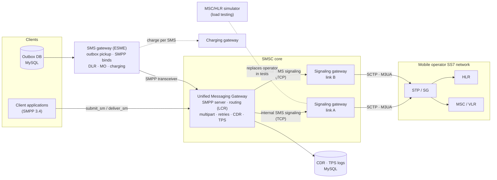
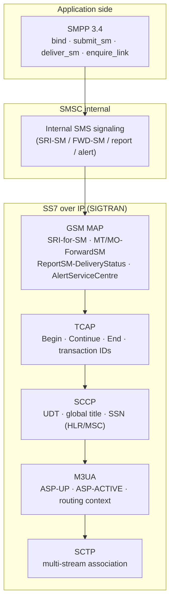
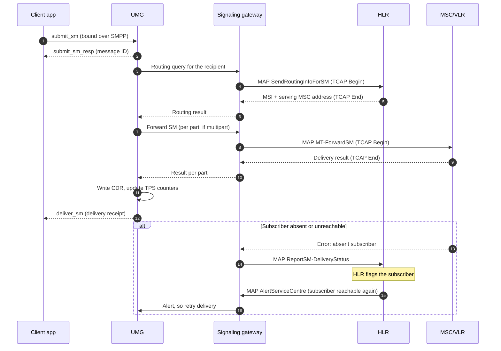

# Carrier-Grade SMSC over SS7/SIGTRAN: Architecture Case Study

> **What this is:** a write-up of the **SMS Center (SMSC)** I built and ran as **Senior Software Engineer at Dotlines Bangladesh** (2020–2023). It carries application SMS onto mobile operator networks over SS7, and peaked at about **3,000 TPS in production**. It was built on the in-house SIGTRAN/MAP protocol stack I worked with earlier at **SSD-TECH** (2015–2020).
> **What this is not:** source code. The code is proprietary, so this repository only documents the architecture, the decisions behind it, and my part in it. Hosts, point codes, global titles, accounts, and subscriber data have all been left out.

**Stack:** C / C++ · POSIX threads · System V IPC · SCTP · M3UA · MTP3 · SCCP · TCAP · GSM MAP · SMPP 3.4 · SNMP · MySQL · Linux

---

## 1. The product

An SMSC delivers SMS to and from mobile phones. This one does it for **application-to-person (A2P)** traffic, such as OTPs, alerts, and campaigns, and handles **mobile-originated (MO)** replies.

- **Client applications** connect over **SMPP 3.4**, the standard SMS API, or submit through a database outbox.
- The platform finds each subscriber's current location in the operator's **HLR** and hands the message to the serving **MSC** over **SS7 (GSM MAP)**. This is done directly on the signaling network, not through another aggregator.
- Long messages are split and reassembled (concatenated SMS). Delivery receipts go back to the client, and every message produces a **CDR** for billing and reporting.
- It runs on several operator links at once, with per-account throughput limits and live TPS monitoring.

## 2. System architecture

| Component | Responsibility |
|---|---|
| **SMS gateway (ESME)** | Pulls queued messages from the outbox with parallel pickup threads, keeps SMPP transceiver binds (with `enquire_link` keep-alive), and submits at a controlled rate. Handles `submit_sm_resp`, delivery receipts, and incoming MO messages. Calls the **charging gateway** per SMS, handles failed charges, and checks number portability (MNP) |
| **Unified Messaging Gateway (UMG)** | The SMPP **server** for client applications: bind authentication, per-application queues, and least-cost routing to the right operator link. Converts each `submit_sm` into a two-step delivery: a routing query (SRI-SM), then forward. Handles multipart split and reassembly, SRI-SM retries, CDR writing, and per-second TPS accounting |
| **Signaling gateway (SGW)** | Speaks SS7 over IP (**SIGTRAN**): SCTP associations, M3UA ASP state and routing keys, MTP3 routing (OPC/DPC/SLS), SCCP global-title addressing, TCAP dialogues, and **GSM MAP** SMS operations. One instance runs per operator link for isolation |
| **MSC/HLR simulator** | A build of the signaling gateway that plays the operator's HLR and MSC, answering routing queries and forwarded SMS. The whole pipeline can be load-tested and regression-tested without touching the live network |

## 3. Protocol stack

## 4. How a mobile-terminated (MT) SMS flows

**Mobile-originated (MO)** messages come in the other way. The MSC sends a **MO-ForwardSM**, the signaling gateway decodes it (TPDU, address, coding scheme), and the message is routed to the subscribed application as a `deliver_sm`, or into the inbox.

## 5. Testing without the operator network

You can't test an SMSC on a live operator network. So the **MSC/HLR simulator** is the same signaling code run in the peer role:

- It accepts the SCTP/M3UA association, answers **SRI-for-SM** with a synthetic IMSI and MSC, and acknowledges **MT-ForwardSM**.
- It can return error codes such as absent subscriber, so retries and delivery reports can be exercised.
- Pointed at a staging SMSC, it supports **load tests** (TPS ramps, multipart, long runs) and protocol regression tests before each release, with packet captures for comparison.

## 6. My role

| | Work |
|---|---|
| **Built (owner)** | **UMG:** SMPP server, per-application queues, multipart handling, SRI-SM retries, message-ID ↔ TCAP-ID correlation, CDR and TPS logging, command interface · **Signaling gateway SMS flows:** MAP SRI-for-SM, MT/MO-ForwardSM, ReportSM-DeliveryStatus, and AlertServiceCentre, encoded and decoded over TCAP/SCCP/M3UA · **SMS gateway (ESME):** outbox pickup, SMPP transceiver binds, delivery receipts, MO handling, charging integration · **MSC/HLR simulator** for load and regression testing |
| **Built on** | SSD-TECH's in-house C/C++ SIGTRAN libraries (M3UA, SCCP, TCAP, MAP, SMPP, SNMP, socket framework), which I had worked with since 2015. At Dotlines I extended the TCAP/MAP and socket layers for the SMS flows |

## 7. Results

- About **3,000 TPS at production peak** across operator links
- **Direct SS7 delivery** (HLR lookup, then MSC hand-off) instead of relaying through third-party aggregators
- **Concatenated SMS**, delivery receipts, absent-subscriber handling with retry on alert, and **MO** routing
- **Per-message CDRs** and per-second TPS monitoring, plus SNMP traps for operations
- A **simulator** that made load and protocol testing repeatable without touching the live network

More detail: [docs/engineering-decisions.md](docs/engineering-decisions.md) · Related: [carrier billing & renewal case study](https://github.com/shubhajit93/telecom-charging-gateway-case-study), the charging gateway the SMS gateway calls for each message.

---

📫 [GitHub profile](https://github.com/shubhajit93) · [LinkedIn](https://www.linkedin.com/in/shubhajit-nandi/)
